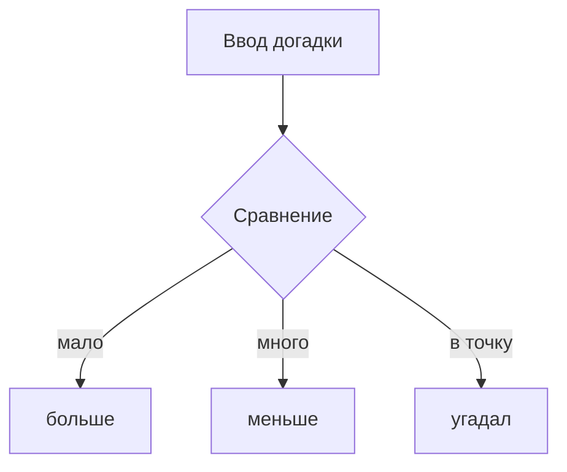

# Угадай число

Игра загадывает число от 1 до 100 и подсказывает, куда двигаться.

## Режимы

| Режим | Диапазон | Победа |
|---|---|---|
| classic | 1–100 | угадал! |

> [!warning]
> Без Node.js 24.12 или новее тесты не запустятся.

## Схема партии

